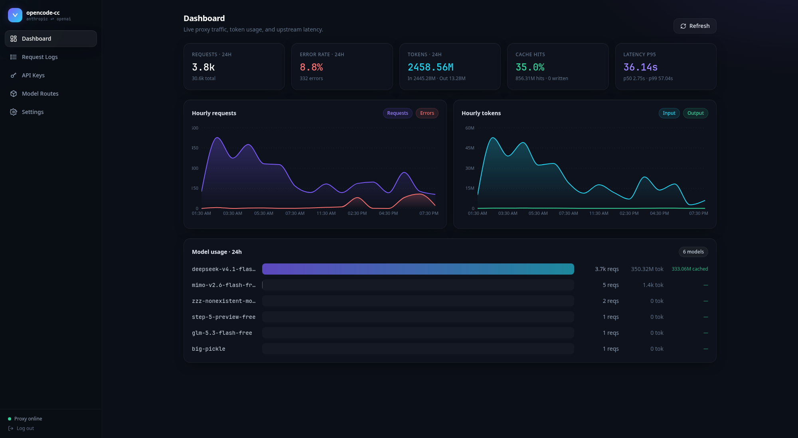

# opencode-cc

**Optional clients:** [Claude Code and T3 Code setup](docs/setup/OPTIONAL_CLIENTS.md).

**Installing this fork on another laptop? Start with [the complete setup and agent handoff](docs/setup/FRIENDS.md).** It covers the exact Claude → patched CPA → relay → Bun helper chain, optional WARP/phone egress, Telegram recovery, credentials, tests and rollback.

> An Anthropic/OpenAI-to-OpenCode Zen multi-protocol bridge proxy with an embedded web dashboard.

`opencode-cc` is a high-performance Go proxy that exposes both the **Anthropic Messages API** and the
**OpenAI Chat Completions API**, with streaming and non-streaming support, and forwards requests to the
**[OpenCode Zen](https://opencode.ai/docs/zen/)** gateway. Zen provides 49 models across four protocols. The proxy
automatically selects the correct protocol translator based on the target model ID, allowing Claude Code to run
transparently with GLM, Kimi, DeepSeek, Qwen, Claude, GPT, Gemini, and other models.

Community: [linuxdo](https://linux.do/)

```text
┌────────────┐  POST /v1/messages   ┌──────────────┐  Route by model ↓      ┌──────────┐
│ Claude Code│ ───────────────────> │ opencode-cc  │ ─────────────────────> │ OpenCode │
│            │ <── Anthropic SSE ── │     (Go)     │ <── Protocol SSE ───── │   Zen    │
└────────────┘                      └──────────────┘                         └──────────┘
                                      Embedded React dashboard ▲ /api/*
                                           SQLite (pure Go, no CGO)
```



## Automatic Routing Across Four Protocols

Zen is not a single OpenAI-compatible endpoint. Its models are exposed through four protocol paths. The proxy selects
the correct path automatically based on the model ID prefix:

| Protocol | Path | Models | Translation |
|----------|------|--------|-------------|
| **OpenAI** | `/v1/chat/completions` | GLM, Kimi, DeepSeek, MiniMax, MiMo, Grok, and free models | Bidirectional Anthropic ↔ OpenAI translation |
| **Anthropic** | `/v1/messages` | Claude and Qwen | Near-transparent passthrough with model ID rewriting only |
| **Responses** | `/v1/responses` | The GPT model family | Anthropic ↔ OpenAI Responses API |
| **Google** | `/v1beta/models/{id}` | Gemini | Anthropic ↔ Google Generative Language |

Each protocol implements the `TranslateRequest`, `TranslateResponse`, and `TranslateStream` methods of the
`upstream.Protocol` interface.

## Features

- **Complete tool-call support.** Anthropic `tool_use` and `tool_result` blocks are translated bidirectionally into
  OpenAI `tool_calls` and `role:"tool"` messages. Claude Code tool definitions are converted into OpenAI function
  tools. The `reasoning_content` extension used by several models is translated into Anthropic `thinking` blocks.
  With `bridge_toolless_resample` enabled, a short tool-less answer can be sampled again; a failed retry leaves the
  first response untouched, while a successful tool retry adds its tool calls without repeating already-streamed text.
- **Automatic routing across four protocols.** Model IDs beginning with `claude-` or `qwen` use Anthropic,
  `gpt-` uses Responses, `gemini-` uses Google, and all other models use OpenAI. No manual protocol configuration is
  required.
- **OpenAI client compatibility.** Supports `POST /v1/chat/completions` and an OpenAI-compatible `/v1/models`
  response, allowing OpenAI SDKs and compatible desktop clients to connect directly. The OpenAI path passes through
  Zen's native `/go/v1/chat/completions` JSON/SSE response without converting it to Anthropic format. Tool calls are
  filtered against the client's declared tool list (see "Phantom marker-tool filtering" below), because the free lane
  injects tools the client never declared.
- **Codex CLI compatibility.** Exposes `POST /v1/responses` and translates Codex Responses API requests, streaming
  text events, and function calls to Zen. OpenAI-compatible target models use `/go/v1/chat/completions`, while
  Claude/Qwen target models can use the native `/v1/messages` upstream path.
- **Smart native Anthropic routing.** `native_anthropic` is enabled by default. Only `claude-*` / `qwen*` target
  models are forwarded directly to upstream `/v1/messages`, preserving `cache_control`, native Anthropic SSE, and
  extension fields. GLM, DeepSeek, Kimi, and other target models continue using translation mode.
- **A built-in catalog of 49 models.** The Models page displays pricing, context limits, capability tags, and protocol
  badges. Models can be added to mappings directly from the Config page.
- **A single static binary.** The React SPA is embedded with `embed.FS`, so Node.js is not required at runtime.
  SQLite uses a pure-Go driver with no CGO dependency, making clean cross-compilation possible.
- **Web dashboard.** Includes Dashboard for traffic and health data, Models for browsing and filtering, Inspector for
  live request details and protocol routing, and Config for Zen settings, proxy authentication, and hot-reloaded model
  mappings.
- **Panel password protection.** When `panel_token` is set in `config.json` or via the Settings page, the web
  dashboard requires password authentication before granting access. After a successful login an HttpOnly session cookie
  (24-hour TTL) is issued to maintain the session. A logout button is available in the sidebar. When `panel_token` is
  empty, the panel remains open — suitable for local, single-user deployments.
- **Client API key management.** Create, disable, and delete client keys from the dashboard, with per-key total token
  quotas, daily token limits, allowed IPs, and automatic usage tracking.
- **Secure defaults.** Constant-time Bearer token authentication, request body size limits, per-request panic recovery,
  and graceful shutdown.

## Quick Start

### Prerequisites

- Go 1.24+
- Node.js 20+ (only required when building the UI)
- An OpenCode Zen API key. Sign in at [opencode.ai/auth](https://opencode.ai/auth), add billing information, and copy
  your API key.

### Build and Run

```bash
(cd web && npm ci --no-audit --no-fund && npm run build)
mkdir -p internal/assets/dist
cp -a web/dist/. internal/assets/dist/
go build -o opencode-cc .
# First installation only; never start over an existing service on this port.
OPENCODE_CC_LISTEN=127.0.0.1:8787 ./opencode-cc -data ./data
```

Open `http://localhost:8787/` and go to the **Config** tab:

1. Enter your **API key** in the "Upstream (OpenCode Zen)" card.
2. Select "Test connection" to verify connectivity.
3. Adjust the Claude Code-to-Zen model mappings under "Model mappings". Several cost-effective defaults are included,
   such as `claude-sonnet-4-5` → `glm-5.1`.

Then point Claude Code at the proxy:

```bash
export ANTHROPIC_BASE_URL=http://localhost:8787
export ANTHROPIC_AUTH_TOKEN=local    # Any value works when proxy auth is disabled
claude
```

If your upstream base URL supports Anthropic Messages, for example `<base>/v1/messages`,
**smart native Anthropic routing** is used by default. You can also set it explicitly:

```bash
export OPENCODE_CC_UPSTREAM=https://opencode.ai/zen/go
export OPENCODE_CC_NATIVE_ANTHROPIC=true
```

When enabled, the proxy first resolves the target model from the mapping table. `claude-*` / `qwen*` target models are
sent directly to upstream `/v1/messages` with only the `model` field rewritten; other target models are still
translated to OpenAI Chat Completions. In the example above, Claude/Qwen target models are forwarded to
`https://opencode.ai/zen/go/v1/messages`. The native path sends both `Authorization: Bearer <key>` and
`x-api-key: <key>` to support OpenAI-style and Anthropic-style authentication.

For the OpenAI SDK or compatible clients, set the base URL to `http://localhost:8787/v1`:

> Select **OpenAI** as the client's API type. A request path of `/v1/messages` means the client is still using
> Anthropic mode, where responses are translated to the Anthropic Messages protocol instead of passed through natively.

```bash
export OPENAI_BASE_URL=http://localhost:8787/v1
export OPENAI_API_KEY=local          # Use a key created in the panel when client authentication is enabled
```

```bash
curl http://localhost:8787/v1/chat/completions \
  -H "Authorization: Bearer $OPENAI_API_KEY" \
  -H "Content-Type: application/json" \
  -d '{"model":"glm-5.1","messages":[{"role":"user","content":"Hello"}]}'
```

### Connect Codex CLI

Codex custom provider settings must be placed in the user-level configuration file:

- Linux/macOS: `~/.codex/config.toml`
- Windows: `%USERPROFILE%\.codex\config.toml`

```toml
model = "kimi-k2.7-code"
model_provider = "opencode_cc"

[model_providers.opencode_cc]
name = "opencode-cc"
base_url = "http://localhost:8787/v1"
env_key = "OPENCODE_CC_API_KEY"
wire_api = "responses"
```

Set the client key before starting Codex. Any non-empty value works when client API key authentication is disabled;
otherwise use a key created in the dashboard:

```bash
export OPENCODE_CC_API_KEY=local
codex
```

PowerShell:

```powershell
$env:OPENCODE_CC_API_KEY = "local"
codex
```

`model` may be a real Zen model ID or an alias configured in the dashboard. `kimi-k2.7-code` is the recommended
coding-oriented model. If the mapping resolves to `claude-*` / `qwen*`, Codex `/v1/responses` requests are converted
to native Anthropic Messages upstream requests; all other target models continue to use OpenAI Chat Completions
translation.

### Development Mode with HMR

```bash
# Terminal 1, only if no relay already owns :8787:
OPENCODE_CC_LISTEN=127.0.0.1:8787 go run . -data /tmp/opencode-cc-dev
# Terminal 2:
cd web && npm run dev
```

### Docker

Build **this checkout** for the Wraient fork. `ghcr.io/kiowx/opencode-cc`
is the upstream project's image; it is not a release of these patches.

```bash
docker build -t opencode-cc:local .
docker run -d --name opencode-cc --restart unless-stopped \
  -p 127.0.0.1:8787:8787 -v opencode-cc-data:/data \
  -e OPENCODE_CC_PANEL_TOKEN=replace-with-your-private-password \
  opencode-cc:local
# Or build the included local-image compose configuration:
# Set OPENCODE_CC_PANEL_TOKEN in a private, untracked .env first.
docker compose up -d --build
```

These commands provide the Go relay/dashboard only. Configure your own Zen key
in the protected panel. For the exact DS Flash Free compatibility and recovery
chain, use the [native Linux setup](docs/setup/FRIENDS.md): the Dockerfile does
not include Bun, CPA, phone egress or Telegram automation. Container loopback
is not the host's loopback; `127.0.0.1:18790` / `:18889` / `:40000` in a container
will not reach host services without deliberate network configuration. Active
OpenCode OAuth also requires its private database to be available read-only
inside the container. This combined container setup has not been accepted here.
Do not expose the panel publicly or paste real credentials into shell history.

## How Translation Works

### Request Routing

When a `POST /v1/messages` request arrives, the proxy looks up `req.Model` in the mapping table to determine the target
Zen model ID. Unmapped model strings are passed through unchanged. It then calls `upstream.Router.For(modelID)` to
select the protocol. All four protocols share a unified output component, `anthropicEmitter`, which emits translated
content blocks as a standard Anthropic SSE event sequence.

### Anthropic ↔ OpenAI Translation

This is the most complex translation path:

| Anthropic | OpenAI Chat Completions |
|-----------|-------------------------|
| `tools[]{name, description, input_schema}` | `tools[]{type:"function", function:{name, description, parameters}}` |
| `content[]{type:"tool_use", id, name, input(object)}` | `assistant.tool_calls[]{id, function:{name, arguments(JSON string)}}` |
| `user.content[]{type:"tool_result", tool_use_id, content}` | `{role:"tool", tool_call_id, content}` |
| `content[]{type:"thinking"}` | `delta.reasoning_content` (DeepSeek/GLM/Kimi extension) |
| `stop_reason:"tool_use"` | `finish_reason:"tool_calls"` |
| Streaming `input_json_delta`, accumulated by index | Streaming `delta.tool_calls[].function.arguments`, accumulated by index |

During streaming, tool-call `arguments` fragments are accumulated by `index`. The completed arguments are then emitted
as a single `tool_use` block, ensuring that Claude Code receives a structurally complete tool call.

### Anthropic Passthrough for Claude and Qwen

Zen exposes a native Anthropic Messages API for Claude and Qwen models. The proxy only rewrites the model ID, while the
request body, response body, and SSE stream are forwarded unchanged. This is the simplest path and requires no tool-call
translation.

### Codex Responses ↔ OpenAI Chat / Anthropic Messages

For `/v1/responses`, the proxy chooses the upstream format by target model. Non-Anthropic-native models are converted
to OpenAI Chat Completions messages, while `claude-*` / `qwen*` target models are converted to Anthropic Messages
requests. Text deltas, streamed tool-call arguments, and usage from Zen are rebuilt as standard Responses events such as
`response.output_text.delta`, `response.function_call_arguments.delta`, and `response.completed`.

This compatibility layer runs locally in the proxy and does not require a native `/v1/responses` endpoint upstream.

### Anthropic ↔ Google for Gemini

`messages[]` becomes `contents[]` with `user` and `model` roles, while `tools[]` becomes
`tools[].functionDeclarations`. Gemini returns streaming JSON arrays whose chunks contain
`candidates[].content.parts[]`; the proxy parses these chunks and converts them into Anthropic increments.

## Configuration

`config.json` is created automatically on first launch:

```jsonc
{
  "listen_addr": ":8787",
  "upstream_base": "https://opencode.ai/inference",
  "native_anthropic": true,   // true smart-routes claude-* / qwen* target models to <upstream_base>/v1/messages
  "zen_api_key": "",           // Required Bearer token for the Zen gateway
  "panel_token": "",           // Web dashboard password; empty means open access
  "require_api_key": false,    // When true, /v1/* always requires a valid client API key
  "default_model": "glm-4.6",
  "model_mappings": [
    // Claude Code model string → actual Zen model ID
    { "match": "claude-sonnet-4-5", "target": "glm-5.1" },
    { "match": "*", "target": "" }  // Pass-through fallback
  ],
  "web_search_mode": "auto",        // auto / native / translate
  "web_search_model": "",           // web_search-specific model; empty means use the main target model
  "web_search_base_url": "",        // native web_search Anthropic upstream; empty means reuse the main upstream
  "web_search_api_key": "",         // native web_search API key; empty means reuse the main upstream key
  "thinking_budget_mappings": [
    // Map Claude Code thinking budget_tokens to model-supported OpenAI extension fields
    { "match": "glm-", "field": "thinking" },
    { "match": "kimi-", "field": "thinking_budget", "low": 1024, "medium": 4096, "high": 8192, "max": 16384 },
    { "match": "moonshot-", "field": "thinking_budget", "low": 1024, "medium": 4096, "high": 8192, "max": 16384 }
  ],
  "log_requests": true,
  "request_timeout_seconds": 0
}
```

Every field can be edited from the **Config** tab. Saving persists the configuration and hot-reloads the bridge by
rebuilding the upstream client, with no restart required. Model strings without a mapping are forwarded to Zen
unchanged.

When an OpenAI-compatible reasoning model returns `reasoning_content`, the proxy converts it into an Anthropic
`thinking` block and replays it as `reasoning_content` on the next upstream request. This satisfies thinking-mode
continuation requirements for models such as DeepSeek and GLM. `thinking_budget_mappings` only adds thinking controls
for explicitly matched models: GLM sends `thinking:{"type":"enabled","clear_thinking":false}` by default, Kimi/Moonshot
send `thinking_budget` by default, and DeepSeek does not receive `thinking_budget`, avoiding incompatible provider
parameters.

Claude Code `web_search_*` server tools support three modes. `auto` keeps the default smart routing behavior;
`native` passes web-search requests through to an Anthropic Messages upstream and can use a dedicated
`web_search_base_url` / `web_search_api_key` pair, for example DeepSeek's Anthropic API; `translate` uses the local
proxy-side search shim and summarizes results with `web_search_model`. The dedicated search API key is only returned
masked from the dashboard API.

## API Endpoints

### Model Proxy APIs

| Method | Path | Description |
|--------|------|-------------|
| POST | `/v1/messages` | Smart-routes by target model: Claude/Qwen use Anthropic, other models use OpenAI Chat translation |
| POST | `/v1/messages/count_tokens` | Best-effort token estimation |
| POST | `/v1/chat/completions` | OpenAI Chat Completions with streaming and non-streaming support |
| POST | `/v1/responses` | OpenAI Responses API for Codex CLI; converts to OpenAI Chat or native Anthropic upstreams |
| GET | `/v1/models` | Model list compatible with both OpenAI and Anthropic clients |
| GET | `/healthz` | Liveness probe |

### Dashboard API

| Method | Path | Auth | Description |
|--------|------|------|-------------|
| GET | `/api/health` | None | Liveness probe |
| GET | `/api/auth/check` | None | Reports whether login is required and whether the current request is authenticated |
| POST | `/api/auth/login` | None | Verifies the panel password and sets an HttpOnly session cookie on success |
| POST | `/api/auth/logout` | None | Destroys the session and clears the cookie |
| GET | `/api/config` | Required | Current configuration snapshot (Zen API key masked) |
| PUT | `/api/config` | Required | Update, persist, and hot-reload the configuration |
| GET | `/api/stats/summary` | Required | Request count and token totals |
| GET | `/api/stats/hourly` | Required | Hourly time series |
| GET | `/api/stats/models` | Required | Per-model usage breakdown |
| GET | `/api/stats/latency` | Required | P50/P95/P99 latency percentiles |
| GET | `/api/logs` | Required | Request log list |
| GET | `/api/logs/{id}` | Required | Individual log entry with request and response bodies |
| GET/POST | `/api/keys` | Required | List or create API keys |
| GET/PUT/DELETE | `/api/keys/{id}` | Required | Read, update, or delete an API key |
| POST | `/api/keys/{id}/reset` | Required | Reset API key usage counters |
| GET | `/api/keys/{id}/usage` | Required | Read API key usage details |
| GET | `/api/test` | Required | Test upstream connectivity |

## Project Structure

```text
opencode-cc/
├── cmd/opencode-cc/        # Entry point
├── internal/
│   ├── config/             # JSON configuration and hot reload
│   ├── anthropic/          # Anthropic Messages API types and SSE writer
│   ├── upstream/           # Zen client and four protocol translators
│   │   ├── protocol.go     # Protocol interface and router
│   │   ├── anthropic.go    # Anthropic passthrough
│   │   ├── openai.go       # OpenAI Chat Completions translation
│   │   ├── responses.go    # OpenAI Responses translation
│   │   ├── google.go       # Google Gemini translation
│   │   ├── stream_emit.go  # Shared Anthropic SSE output
│   │   ├── models.go       # Catalog of 49 Zen models
│   │   └── client.go       # HTTP client with Bearer auth and GET /v1/models
│   ├── bridge/             # /v1/messages handler: route, translate, forward
│   ├── store/              # SQLite through modernc, with no CGO
│   └── web/                # Dashboard API and embedded SPA
├── web/                    # React, Vite, and Tailwind source
│   └── src/pages/{Dashboard,Inspector,Models,Config}.tsx
└── Dockerfile              # Multi-stage Node.js, Go, and distroless build
```

## Notes

- **Protocol-routing tradeoffs.** Translation from Anthropic to OpenAI, Responses, or Google is lossy because some
  Anthropic-specific concepts, such as `cache_control` and complete `thinking` signatures, have no equivalent in the
  target protocols. The Claude and Qwen passthrough path does not have this limitation.
- **Token usage.** The OpenAI path obtains exact counts from streaming `include_usage` chunks. Other protocols use
  upstream usage fields when available and fall back to estimates otherwise.
- **The model catalog may become outdated.** `internal/upstream/models.go` is a manually curated snapshot. Prices and
  capabilities can change. Use `GET https://opencode.ai/zen/v1/models` with an API key to retrieve the latest catalog.
- **Older SQLite databases are incompatible.** The schema changed during refactoring: `session_map` was removed and the
  `requests` fields changed. During development, delete `data/*.db`. Versioned migrations will be added for production.

## Measured TTFT and throughput (2026-10-02)

20-request runs against the live service, `space-bunny`, sequential, after the
connection-warmth and retry changes. `ttfb` = first byte of the response;
`ttft` = first content or reasoning token (the number a user perceives);
`tok/s` = output tokens divided by the time *after* the first token, so it
measures decode rate rather than prefill.

Short answers (`max_tokens=32`, "Say hi in three words."):

| Run | ok | ttft p50 | ttft p90 | ttft max | tok/s p50 | total p50 |
| --- | --- | --- | --- | --- | --- | --- |
| `:8787` opencode-cc direct | 20/20 | 2072ms | 9712ms | 18125ms | 21.9 | 2636ms |
| `:8317` full chain (`space-bunny-oc`) | 20/20 | 1998ms | 4669ms | 20616ms | 19.4 | 2436ms |

Long answers (`max_tokens=1500`, an eight-paragraph explanation, forcing real
prefill and decode):

| Run | ok | ttft p50 | ttft p90 | total p50 | tok/s p50 | tok/s p90 |
| --- | --- | --- | --- | --- | --- | --- |
| `:8787` opencode-cc direct | 20/20 | 1490ms | 5845ms | 15073ms | 108.5 | 142.8 |
| `:8317` full chain | 19/20 | 1880ms | 4845ms | 29655ms | 55.7 | 66.9 |

How to read this:

- **TTFT is upstream-bound.** Best observed ttft is ~810-1156ms, essentially
  the edge TTFB floor, and the proxy adds 1-2ms of its own. There is no
  meaningful proxy-side latency left to remove.
- **Tail latency is Zen free-tier queueing**, not the proxy: the p90/max spread
  is 5-18x and varies run to run. Retrying made it visible in the log —
  `upstream attempt 1 timeout (net/http: timeout awaiting response headers),
  retrying` — and those requests then completed normally.
- **tok/s ~100-140 for long generations** is the model's decode rate on this
  free tier. Short-answer tok/s looks wild (3-30) simply because 6-9 output
  tokens make the denominator meaningless; do not read it as a speed change.
- The `:8317` chain adds cli-proxyapi's own translation hop, visible as lower
  tok/s at p50 on long answers (55.7 vs 108.5) — that is the extra hop, not a
  regression in opencode-cc.

Harness used (kept out of the repo, it is a measurement tool, not product
code): a streaming client that timestamps first byte, first content token, and
reads authoritative `usage` from the trailing chunk.

## Upstream retry coverage (2026-10-02)

The stall that produced `auth_unavailable ... timeout awaiting response
headers` was not isolated to one route. Every upstream call site now goes
through `doUpstreamWithRetry`:

| Route | File | Before |
| --- | --- | --- |
| `/v1/chat/completions` | `openai_proxy.go` | no retry |
| `/v1/messages` (Anthropic) | `proxy.go` (translated + native) | no retry |
| `/v1/responses` (Codex) | `responses_proxy.go` (both branches) | no retry |

`isTimeoutErr` additionally classifies `io.EOF`/`io.ErrUnexpectedEOF` as
retryable: the edge closing a pooled socket before response headers is
transient and nothing downstream depends on that attempt. Retries stay bounded
(3 attempts on timeout, 2 on 5xx, 2s backoff) and stop immediately if the
downstream client has disconnected.

Two latent crashes were fixed alongside, both found by the new tests: a nil
`store` dereference inside the *logging goroutine* (`logSuccessWithCache` /
`logFailed` run in `go func()`), which would panic the whole process rather
than fail one request when request logging is disabled. `store` is now
nil-guarded at both call sites.

## Time-to-first-token: connection warmth (2026-10-02)

TTFT here is dominated by upstream network cost, not by proxy work. Measured
with a local instant-response mock upstream, the proxy's own CPU/processing
overhead is **1-2ms**; a cold-connection benchmark against the real Zen edge
showed the decisive costs:

| Factor | Measured | Note |
| --- | --- | --- |
| Proxy processing overhead | 1-2ms | mock upstream, so noise-free |
| Fresh TCP+TLS handshake | ~562ms | paid on every cold connection |
| Warm connection vs. cold | ~610ms faster | the dominant controllable win |
| Edge TTFB once warm (H1) | ~498ms | `/v1/models`, 41 samples |
| Edge TTFB once warm (H2) | ~520ms | H2 is *not* faster; irrelevant vs H1 |
| Idle gap ≤ 60s | stays warm | connection reused |
| Idle gap ≥ 90s | **+900ms** | old `IdleConnTimeout` reap cliff |

So the previous `IdleConnTimeout: 90s` was a self-inflicted TTFT cliff: any
turn starting after 90s of quiet (normal when a user reads output or pauses)
re-handshaked TLS. Three changes:

- `IdleConnTimeout` raised `90s` → **1h**, with an explicit `net.Dialer` whose
  TCP `KeepAlive` (75m) outlives it. Previously the transport silently used
  `net/http`'s default dialer, whose 30s TCP keep-alive is *shorter* than the
  idle window and let the OS reap supposedly-warm sockets early.
- `MaxIdleConnsPerHost` `16` → **32** and `MaxIdleConns` `100` → **256`, so
  parallel-subagent bursts reuse pooled sockets instead of dialing new ones.
- New `internal/server/keepalive.go` pings each enabled upstream with one cheap
  `GET /v1/models` every **45s** through the shared transport, so the pool
  stays warm across long thinking gaps. It reuses the real pool, ignores
  failures (a real request reports outages better), never touches the upstream
  slot semaphores, and stops when `Shutdown` closes the server's `done` channel.

Upstream is deliberately still **HTTP/1.1 only**. H2 measured no faster, and
the Sep 2026 SIGQUIT forensics in `server.go` document a real H2 flow-control
wedge that wedged every route sharing the client.

Separately, `/v1/chat/completions` had no upstream retry, so a Zen stall became
a hard 502 (the `auth_unavailable: ... timeout awaiting response headers` seen
from cli-proxy-api). It now uses the existing `doUpstreamWithRetry` helper —
safe because nothing is written downstream yet and the POST has no side
effects. Verified against a deliberately stalling mock: 35s stall on the first
attempt now returns `200` on retry instead of failing.

Post-deploy, three consecutive turns through cli-proxy-api `:8317` separated by
100s idle gaps ran **1.24s / 1.29s / 1.39s** with a single warm upstream
connection held throughout.

### Rate-limit / cooldown propagation (Oct 2026)

Zen signals exhaustion with `retry-after` on its 429. Measured directly against
Zen during a free-tier lockout:

```
HTTP/2 429
retry-after: 52638          # ~14.6 hours — the rest of the daily window
```

That header used to be **discarded**, so every downstream hop saw a bare `429`
with no timing information. Each hop then invented a short backoff, retried
into the same wall, and the chain stalled even though the cooldown was known and
very long. `internal/server/cooldown.go` makes the signal survive the hop:

- Upstream `retry-after` wins and is re-emitted verbatim (both the
  `/v1/messages` and `/v1/chat/completions` lanes).
- `x-ratelimit-reset` is accepted as a fallback, in both epoch and HTTP-date
  form.
- When an upstream sends no usable value, a **progressive ladder** is used
  instead of an instant retry: 30s → 2m → 5m → 10m → 15m, capped. A lane that
  answers again (`logSuccessWithCache`) or a quiet gap at least as long as the
  step just handed out resets the ladder, so a transient blip still recovers
  quickly while a genuinely dead lane stops being hammered.
- Values are clamped to `[5s, 24h]`. The 24h ceiling is above Zen's own daily
  window, so the real signal passes through intact; the floor stops a
  header-less 429 from becoming a hot loop.
- Non-429 responses never get a `Retry-After`.

Downstream responses carry `Retry-After` plus the `x-ratelimit-*` family, with
the epoch form kept consistent with `Retry-After` so a client reading either
waits the same amount of time.

Verified live: Zen's 429 surfaces at `http://127.0.0.1:8787` as
`Retry-After: 52051`, and cliproxyapi's log shows it parking the credential for
`remaining=14h26m4s` instead of the previous `1m30s`.

Zen's free lane gates on the exact tool shape the official OpenCode client
sends, so `PrepareFreeChatBody` injects two marker tools — `shell` and `read` —
into every free-model request. Those tools are **not** declared by the
downstream client, and the model occasionally calls one spontaneously.

The `/v1/messages` lane already handled this: `StreamConverter.RestrictTools`
resolves such names through `proxy.ResolveDeclaredToolName` (`shell` → the
client's `Bash`/`bash`, `default.shell` → same after namespace stripping) so the
call survives as a real tool call instead of stalling the agent loop.

`/v1/chat/completions` — the lane **OpenCode itself** uses — was a raw byte
relay with no such filtering, so a phantom `shell` call reached the client
verbatim. OpenCode has no such tool, so the turn died with a tool-not-found
error. `internal/server/openai_toolfilter.go` applies the same resolution to the
streaming Chat Completions wire format:

- Marker names are **renamed** to the client's declared equivalent.
- Unresolvable names are **dropped**, and a choice that lost every call has its
  `finish_reason` corrected from `tool_calls` to `stop` — otherwise OpenAI SDKs
  treat it as "calls to run" and wait forever for tool results that never come.
- Verdicts are cached per `(choice, tool-call index)`, so argument-only
  continuation fragments inherit the decision made when the name arrived.
- Lines with no tool calls are returned **byte-identical**, keeping the common
  path a pure relay and preserving unknown upstream fields.

Verified on staging: with a client declaring only `bash`, an upstream `shell`
call arrives as `bash` with `finish_reason: tool_calls`; with a client declaring
neither, it is dropped and the reason falls back to `stop`.

Operational note: the request log (`~/data/opencode-cc.db`) has no pruning and
had reached **215MB / 10,218 rows** (avg 21KB of bodies per row) while the
root filesystem sat at 98%. That is unrelated to TTFT — inserts happen in
background goroutines, off the critical path — but it is a disk-space risk
worth adding retention for.

## Local harness compatibility (updated 2026-10-15)

The default upstream is the current v2 `https://opencode.ai/inference` endpoint.
Explicit upstream URLs, including Zen Go and custom backends, remain configurable.
The proxy supports the current free-tier request contract used by Claude Code and
Grok Build. Free model requests are sent upstream in the official OpenCode
shape: `opencode/latest/<version>/cli` User-Agent, canonical
`x-opencode-session` (`ses_` + 12-hex descending timestamp + 14 base62,
byte-identical construction to opencode's `Identifier.descending()`),
matching `x-session-affinity`/`x-session-id`, `x-opencode-session-id`,
`stream:true`, and the released `shell` and `read` tool definitions when missing
from the harness. Empty placeholder schemas no longer work. The obsolete
`x-opencode-request` header is omitted, matching v2.0.29. Adding it to a working
CLI request independently caused 403 on 2026-10-15. Since
2026-10-13 Zen validates the session *value* on the free-tier lane
(`FreeTierError` for hash-shaped/all-hex sessions), synthesized sessions use
a genuine descending-timestamp prefix for the current 12h bucket with a
hash-derived tail (stable sticky routing, always fresh). The caller's
actual tools and response mode are preserved; forced SSE is aggregated back to
JSON for non-streaming clients. The compatibility layer lives in
`internal/proxy/free_tier.go` and `internal/proxy/stream_aggregate.go`, with
protocol wiring in `internal/server/{proxy.go,openai_proxy.go,responses_proxy.go,responses_passthrough.go,anthropic_responses.go}` and
session synthesis in `internal/server/zen_headers.go`.

The local deployment uses `muse-spark-1.3-contributor-free` with `xhigh`
reasoning for both harnesses:

```bash
# Claude Code
claude-oc -p 'Reply with exactly OK' --no-session-persistence --output-format json

# Grok Build
grok -p 'Reply with exactly OK' --no-plan --max-turns 1 --output-format json
```

### Upstream compatibility checks (2026-10-15)

The free tier failed closed with `403 FreeTierError` ("can only be used from
within OpenCode") for a *long-standing* proxy that looked correct. Our
hand-maintained request contract had drifted from the released CLI.
On 2026-10-15, controlled probes found two independent 403 triggers: empty
placeholder tool schemas and an obsolete `x-opencode-request` header. Session
shape was only one part of compatibility.

The audited source is v2.0.29, commit
`042d0832f5f3a73eaa039a58a7d565776f6d4290`. Its tool definitions, MIT license,
and source hashes are versioned in `internal/proxy/opencode/`. See
[the audit and benchmark](docs/opencode-parity-2026-10-15.md).

Run `python scripts/check_opencode_source.py --source /path/to/opencode --latest`
to detect release/source drift. Run `scripts/bench_opencode_parity.py` with an
isolated staging proxy and the released CLI to test the actual upstream
contract, TTFT, throughput, and bounded concurrency. These are opt-in network
checks; the unit tests alone cannot prove that a remote gateway still accepts
a request. No background updater or recurring network test is installed.

If free-tier requests fail again, check these in order:

| Symptom | Likely cause | Check |
|---|---|---|
| `403 FreeTierError` despite valid session | upstream contract drift | capture the released CLI; check obsolete headers and complete tool schemas first |
| `403 FreeTierError` on every free request | session id is not genuine-shaped | the 12-hex prefix must decode as a **descending** timestamp (`~(ts_ms*0x1000+ctr)`); an all-hex/sha256 session is rejected |
| `200` locally, `403` from a harness | harness sends its own session header | an all-hex or stale (>24h) downstream session must be re-synthesized, never forwarded |
| Intermittent `403` after ~12h | session timestamp went stale | the prefix tracks a 12h bucket; check `sessionBucketMillis` |
| Tool calls die with "tool not found" | phantom marker tool reached the client | see "Phantom marker-tool filtering" above; `chatToolCallFilter` must resolve `shell`/`read` against the declared tool list |
| Stream chunks silently ignored | SSE framing corrupted by a rewrite | every emitted line must still start with `data:`; `TestRelayPreservesSSEFramingOnRewrite` pins this |

`go test ./internal/server/ -run 'TestChatProxy|TestRelayPreservesSSEFraming|TestSynthSessionIDGateShape'`
covers the session gate, the tool filter, and the SSE framing contract.

See `~/.config/opencode-cc/README.md`, `~/.claude/README.md`, and
`~/.grok/README.md` for service, backup, and troubleshooting details.

## Optional OpenCode client retry policy

The [native retry plugin](contrib/opencode/rate-limit-retry/README.md) honors
`Retry-After`, persists account/model cooldowns, bounds retries, and avoids
inserting synthetic user messages. It includes unit tests and an isolated
real-CLI recovery harness verified with OpenCode v2.0.24 and v2.0.29. Provider
quotas and cache expiry still apply; the plugin controls recovery behavior.

## Use the active OpenCode Console credential

For an OpenCode inference upstream, set its `api_key` to `opencode://active` in
the upstream pool. This opt-in reference reads the active `opencode` credential
from the official v2 CLI's SQLite database for each request. It follows token
rotation without saving access tokens in the relay configuration or using the
CLI's refresh token. Only HTTPS `opencode.ai` destinations accept this reference.

The default database is `$XDG_DATA_HOME/opencode/opencode.db`, or
`~/.local/share/opencode/opencode.db`. Set `OPENCODE_CC_OPENCODE_DB` to override
its path. The service user must be able to read it. Missing, ambiguous, malformed,
or expired credentials stop locally; the relay never falls back to an old key.
OpenCode remains responsible for OAuth renewal and reconnection. This reference
does not guarantee that the provider will keep accepting a model or network path.

## Optional upstream network proxy

The upstream HTTP transport honors `HTTP_PROXY`, `HTTPS_PROXY`, and `NO_PROXY`.
Set them in the environment of the proxy service before starting it; setting them
only in a client shell does not change an already running service. Loopback
requests stay direct.

For an already connected Cloudflare WARP local proxy:

```sh
HTTPS_PROXY=socks5h://127.0.0.1:40000
HTTP_PROXY=socks5h://127.0.0.1:40000
NO_PROXY=127.0.0.1,localhost,::1
```

This changes the network path only. Upstream authentication, model availability,
and access restrictions still apply. Verify inference on isolated staging before
changing a live service. See the [October 18 diagnosis](docs/diagnostics/2026-10-18-free-tier-rejection.md)
for the WARP test and the expired relay credential it exposed.

## License

MIT
